<picture>
  <source media="(prefers-color-scheme: dark) and (max-width: 600px)" srcset="./assets/hero-dark-mobile.svg?v=20261030-5">
  <source media="(max-width: 600px)" srcset="./assets/hero-light-mobile.svg?v=20261030-5">
  <source media="(prefers-color-scheme: dark)" srcset="./assets/hero-dark.svg?v=20261030-5">
  
</picture>

  <a href="https://whp.plus">个人博客 · whp.plus</a>
  &nbsp; · &nbsp;
  <a href="https://github.com/oiOxOio?tab=repositories">浏览公开仓库</a>

<picture>
  <source media="(prefers-color-scheme: dark) and (max-width: 600px)" srcset="./assets/skills-dark-mobile.svg?v=20261030-5">
  <source media="(max-width: 600px)" srcset="./assets/skills-light-mobile.svg?v=20261030-5">
  <source media="(prefers-color-scheme: dark)" srcset="./assets/skills-dark.svg?v=20261030-5">
  
</picture>

<picture>
  <source media="(prefers-color-scheme: dark)" srcset="./assets/contributions-dark.svg">
  
</picture>

<picture>
  <source media="(prefers-color-scheme: dark) and (max-width: 600px)" srcset="./assets/stats-dark-mobile.svg?v=20261030-2">
  <source media="(max-width: 600px)" srcset="./assets/stats-light-mobile.svg?v=20261030-2">
  <source media="(prefers-color-scheme: dark)" srcset="./assets/stats-dark.svg?v=20261030-2">
  
</picture>
