<picture>
  <source media="(prefers-color-scheme: dark) and (max-width: 600px)" srcset="./assets/hero-dark-mobile.svg">
  <source media="(max-width: 600px)" srcset="./assets/hero-light-mobile.svg">
  <source media="(prefers-color-scheme: dark)" srcset="./assets/hero-dark.svg">
  
</picture>

<picture>
  <source media="(prefers-color-scheme: dark) and (max-width: 600px)" srcset="./assets/skills-dark-mobile.svg">
  <source media="(max-width: 600px)" srcset="./assets/skills-light-mobile.svg">
  <source media="(prefers-color-scheme: dark)" srcset="./assets/skills-dark.svg">
  
</picture>

<picture>
  <source media="(prefers-color-scheme: dark)" srcset="./assets/contributions-dark.svg">
  
</picture>

<picture>
  <source media="(prefers-color-scheme: dark) and (max-width: 600px)" srcset="./assets/stats-dark-mobile.svg">
  <source media="(max-width: 600px)" srcset="./assets/stats-light-mobile.svg">
  <source media="(prefers-color-scheme: dark)" srcset="./assets/stats-dark.svg">
  
</picture>

  <a href="https://github.com/oiOxOio/codex-plugins">Codex 插件</a>
  &nbsp; · &nbsp;
  <a href="https://demo3.whp.plus/">抽陀螺 · 在线体验</a>
  &nbsp; · &nbsp;
  <a href="https://github.com/oiOxOio/Smart-Album">Smart Album</a>
  &nbsp; · &nbsp;
  <a href="https://github.com/oiOxOio?tab=repositories">更多公开项目</a>

  
关于我 · 文字版

我是 **oiOxOio / Why.Ping**，一名全栈开发者。喜欢从真实业务问题出发，把需求、数据、规则、界面和部署串成完整的产品。

目前关注的方向：

- **规则引擎与 CPQ**：围绕 dx-cloud 规则引擎，推进非标模架报价的参数整理、规则配置和自动计价。报价信息由人工整理录入，系统负责按规则计算价格。
- **数据平台与服务端**：关注结构化数据、版本记录、PostgreSQL 与服务边界，希望系统既能承载业务，也方便后续维护。
- **Web 3D 与交互体验**：持续打磨[抽陀螺](https://demo3.whp.plus/)等互动项目，关注光影材质、操作反馈、移动端性能和加载速度。
- **开发工具与可视化**：维护 [Codex 插件集合](https://github.com/oiOxOio/codex-plugins)，探索 AI 辅助开发，以及 CAD / CNC / EIA 刀路可视化。

常用与实践中的技术包括 **Java、Spring Boot、PostgreSQL、JavaScript、Three.js、Docker 和 Cloudflare**。

我重视可维护的实现、流畅的使用体验，以及真正解决问题的工具。

